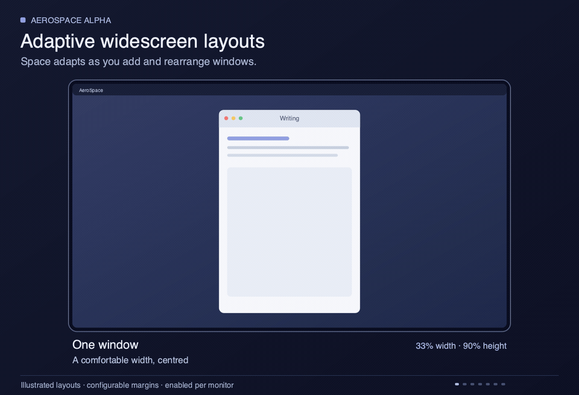

<p align="center">
  
</p>

<h1 align="center">AeroSpace α</h1>

<p align="center">
  An extended alpha build of <a href="https://github.com/nikitabobko/AeroSpace">AeroSpace</a>, the i3-like tiling window manager for macOS,<br>
  with pending upstream fixes, adaptive widescreen layouts and Focus Mode,<br>
  and multi-monitor support that works, using the occasional private API<br>
  that would never make it into the main build.
</p>

<p align="center">
  <a href="https://github.com/JasonBates/AeroSpace-Alpha/releases/latest">download</a> ·
  <a href="https://github.com/nikitabobko/AeroSpace">upstream</a> ·
  <a href="docs/quick-start.md">quick start</a> ·
  <a href="docs/personal-build.md">build notes</a> ·
  <a href="LICENSE.txt">MIT</a>
</p>

<br>

## How it differs from AeroSpace

AeroSpace is a superb project: i3-style tiling on macOS, a plain-text config, a scriptable CLI, and no need to disable SIP. Alpha builds on that foundation and changes nothing about it. It adds a layer of upstream fixes that are still waiting to be merged, and a layer of features of its own on top.

<p align="center">
  
</p>

The bottom layer is upstream `main`, unchanged. The middle layer is a set of open upstream pull requests merged as they are, so bugs that upstream already has fixes for are fixed here now. The top layer is what I built for a three-monitor desk and a laptop. Everything else, from the config format to the CLI to the docs, is upstream's, and the credit for it belongs there.

One rule separates the two projects. Upstream does not use private macOS APIs, and holds to that even where the public APIs cannot do the job. Alpha uses them when there is no other way: today that is the SkyLight call that makes focus land on the right window across monitors. Those pieces can never be merged upstream, which is why this build exists.

Alpha adds:

- **Multi-monitor focus and movement work.** Focus lands on the window you asked for, hidden windows stay hidden and stop costing GPU time, a workspace on one monitor no longer flips because of an app on another, and displays can reconfigure without a crash.
- **Floating windows behave.** They can be resized, centred, nudged from the keyboard and placed by rule, and dragged across monitors without jumping back.
- **Adaptive widescreen layouts.** Windows stay comfortably centred on a large display, with more space opening up as you add columns or rows.
- **Focus Mode.** Centre the window you are working in and dim the rest, then return to your layout.
- **A native focused-window border**, if you want one, with no extra daemon.
- **Workspace bars get events** instead of polling.
- **Apps that go quiet are not mistaken for closed ones**, and apps macOS 27 reports with no process are still managed.

## What Alpha adds

### Adaptive widescreen layouts

A large monitor should feel comfortable with one window and useful with six.
Alpha adjusts the space used by your layout as you add windows or move them
between rows and columns.

<p align="center">
  
</p>

*Illustrated layouts, not a screen recording. [Watch the video](docs/assets/adaptive-widescreen-demo.mp4) · [View a still](docs/assets/adaptive-widescreen-demo-preview.png).*

- **One window:** a narrow, centred working area.
- **Two columns, or a vertical stack:** a wider area with side margins.
- **Three or more columns:** use the full width.
- **One row:** keep space above and below. **Multiple rows:** use the full height.

These choices work independently: two windows above a third keep the side
margins while using the full height. Resize the splits as usual; uneven
proportions survive layout changes. Tiled windows have a configurable 200-point
minimum height on every display, so a vertical resize cannot collapse a stacked
window into a strip. Focus Mode and fullscreen remain available.

Enable this on the displays you choose and adjust the percentages to suit you.
The animation uses 33% and 66% widths, with 90% height for a single row. Normal
window gaps remain. See the [large-monitor setup](docs/quick-start.md#add-margins-on-a-large-display)
for the four config lines, or the [build notes](docs/personal-build.md#adaptive-widescreen-layouts)
for how layouts are counted and resized.

On other displays, the starter config centres a lone window at 66% width, or
50% on displays at least 2000 macOS display points wide. Multiple windows use
the normal tiling area. Both modes support resizing from the keyboard.

### Multi-monitor focus and movement that work

With "Displays have separate Spaces" on and an app open on two monitors, stock AeroSpace often focuses the wrong window: you ask for the Ghostty window on the right monitor, macOS raises it, and your keystrokes go to the one on the left ([issue #101](https://github.com/nikitabobko/AeroSpace/issues/101), open since 2024). Alpha fixes this with the SkyLight call from [PR #2179](https://github.com/nikitabobko/AeroSpace/pull/2179), so `focus` and `move` across monitors land where the highlight is, every time. Around it:

- Hidden windows on a middle monitor no longer flicker back into view, see [below](#hidden-windows-stay-hidden).
- Reconfiguring displays, plugging in or waking, no longer crashes AeroSpace ([#2232](https://github.com/nikitabobko/AeroSpace/pull/2232)).
- A monitor that macOS has already dropped, as when the lid closes with external displays attached or every display is briefly off, no longer crashes AeroSpace in an endless retry; it gets a placeholder workspace until the next refresh. Fix from [AeroSpace-edge](https://github.com/vitorebatista/AeroSpace-edge) ([PR #64](https://github.com/vitorebatista/AeroSpace-edge/pull/64)).
- `move-workspace-to-monitor` chooses the replacement workspace before moving ([#1944](https://github.com/nikitabobko/AeroSpace/pull/1944)).
- A cancelled focus request cannot steal focus from a newer one ([#2299](https://github.com/nikitabobko/AeroSpace/pull/2299)).
- Switching workspaces on one monitor no longer silently changes the workspace on another when an app has windows on both ([#2280](https://github.com/nikitabobko/AeroSpace/pull/2280)).
- `move --boundaries all-monitors-outer-frame --boundaries-action wrap-around-all-monitors` carries a window from the outer edge of the monitor row round to the opposite monitor ([#2319](https://github.com/nikitabobko/AeroSpace/pull/2319)).
- `move --boundaries all-monitors-outer-frame --tile-before-monitor` gives a multi-window workspace one move to tile along the requested axis before the next move crosses to a neighboring monitor.

Tested daily on three side-by-side monitors and a laptop.

### Focus Mode

Press **Option+Return** in the starter config to centre the focused window and
dim the others. Press it again, click outside, or switch workspace to return to
the tiled layout. Width and height can be resized while focused.

<p align="center">
  
</p>

The starter shortcut keeps the window on its current display:

```toml
alt-enter = 'focus-mode --stay-on-monitor'
```

Use `focus-mode` without that option to bring the window to the middle display
on a three-monitor desk, or the main display with two monitors. Existing users
can bind either command to their preferred shortcut.

### Floating windows that behave

- **`center`** centres a floating window on its monitor, shrinking it first if it is larger than the screen.
- **`resize` works on floating windows.** The window resizes around its centre and stays inside its monitor. `width` and `height` change one side; `smart` changes the longer side and `smart-opposite` the shorter, keeping the aspect ratio.
- **`move` nudges a floating window** in the given direction, by `--floating-pixels <n>` or a tenth of the monitor when the flag is omitted ([#2248](https://github.com/nikitabobko/AeroSpace/pull/2248)).
- **Dragging a floating window to another monitor lands it where you drop it.** Stock AeroSpace often pulls the window back to the monitor it came from ([issue #347](https://github.com/nikitabobko/AeroSpace/issues/347)), and with three monitors a drag from the first to the third reliably ends on the second. A layout pass was moving the window while the drag handler was still catching up; the window is now left alone until the mouse button is released, then bound to the monitor under it. Fix offered upstream on that issue.

Together with `on-window-detected` a rule can open a window floating, sized and centred:

```toml
[[on-window-detected]]
    if.app-id = 'com.apple.QuickTimePlayerX'
    run = ['layout floating', 'resize smart 1600', 'center']
```

### Events for workspace bars

`aerospace subscribe` gains `window-closed` and `window-moved`, so a bar can follow windows without polling `list-windows`. `window-moved` also reports moves made by `on-window-detected` callbacks, and minimising or restoring a window.

### Hidden windows stay hidden

AeroSpace parks the windows of invisible workspaces in a bottom corner of their monitor. When a monitor sits between two others, both of its bottom corners touch a neighbour, macOS pulls the parked window back onto that neighbour, and it flickers at the edge of the screen. Such a monitor now parks hidden windows in the nearest clean outer corner of another monitor.

Parked windows also stop costing GPU time. A parked window keeps a one-point sliver on screen, so macOS reports it as visible and browsers, Electron apps and games keep rendering it at full rate; one Firefox page on a hidden workspace was measured at a third of a core ([discussion #2323](https://github.com/nikitabobko/AeroSpace/discussions/2323)). Alpha covers each parking corner with a one-point opaque strip, so parked windows count as occluded and the apps throttle themselves. `hidden-windows-occlusion-cover = false` turns it off.

### A native focused-window border

AeroSpace can draw the focused-window highlight itself: a coloured, rounded, click-through border that follows every focus change, move, resize and workspace switch. It started as upstream [PR #2107](https://github.com/nikitabobko/AeroSpace/pull/2107) and was reworked here for speed: the frame comes from the WindowServer rather than an Accessibility round trip, focus changes redraw at once, and while a mouse button is held the border follows the window at 60 Hz, so a dragged or resized window keeps its border. It replaces JankyBorders and needs no extra process. Off by default.

```toml
focused-window-border = true
focused-window-border-color = '0xff12B981'  # 0xAARRGGBB, as in JankyBorders
focused-window-border-width = 4
focused-window-border-radius = 10
focused-window-border-inset = 0             # pull the stroke into the window to hide corner-radius mismatches
```

### Aspect ratio for a lone window

The single-window and accordion aspect-ratio work from upstream [PR #2093](https://github.com/nikitabobko/AeroSpace/pull/2093), adapted to the current code. Alpha's width rules build on it.

## Upstream fixes included

Open upstream pull requests merged unchanged, except where noted. Credit belongs to their authors.

| PR | Fixes |
|---|---|
| [#2179](https://github.com/nikitabobko/AeroSpace/pull/2179) | With separate Spaces per display, focus lands on the requested window of a multi-window app instead of one on another monitor ([#101](https://github.com/nikitabobko/AeroSpace/issues/101)). Adapted to the `MonitorInfo` rename. |
| [#2225](https://github.com/nikitabobko/AeroSpace/pull/2225) | A new native tab in Finder or Ghostty takes its predecessor's place in the tree ([#68](https://github.com/nikitabobko/AeroSpace/issues/68)). |
| [#2174](https://github.com/nikitabobko/AeroSpace/pull/2174) | A window returns to its place in the layout after macOS native full screen. |
| [#2201](https://github.com/nikitabobko/AeroSpace/pull/2201) | Focus is restored after a transient dialog closes. |
| [#2348](https://github.com/nikitabobko/AeroSpace/pull/2348) | When a floating window such as a Touch ID or 1Password prompt closes, focus returns to the window used before it rather than the first window of the workspace ([discussion #2200](https://github.com/nikitabobko/AeroSpace/discussions/2200)). Complements #2201. |
| [#2299](https://github.com/nikitabobko/AeroSpace/pull/2299) | A cancelled focus request no longer steals focus from a newer one. |
| [#2220](https://github.com/nikitabobko/AeroSpace/pull/2220) | A window made floating by `on-window-detected` no longer stays at its tile position. |
| [#2281](https://github.com/nikitabobko/AeroSpace/pull/2281) | No `focus` crash when a floating window moves or closes during the command. |
| [#2232](https://github.com/nikitabobko/AeroSpace/pull/2232) | No crash while displays are being reconfigured. |
| [#1944](https://github.com/nikitabobko/AeroSpace/pull/1944) | `move-workspace-to-monitor` chooses the replacement workspace before moving. |
| [#2317](https://github.com/nikitabobko/AeroSpace/pull/2317) | The windows of an app that hangs or is too busy to answer Accessibility requests are no longer treated as closed ([#1216](https://github.com/nikitabobko/AeroSpace/issues/1216)). Merged by hand with #2225's native-tab handling. |
| [#2326](https://github.com/nikitabobko/AeroSpace/pull/2326) | When an app does not answer the window enumeration in time, as under load after boot, the refresh is retried with backoff instead of leaving its windows undetected ([#1615](https://github.com/nikitabobko/AeroSpace/issues/1615)). Ported by hand onto #2317. |
| [#2280](https://github.com/nikitabobko/AeroSpace/pull/2280) | Activating an app with windows on two monitors no longer pulls a hidden workspace onto the other monitor. Narrowed here: the off-screen window is ignored only while the app has a window on a visible workspace, so Cmd-Tab, Dock and notification clicks to an app on a hidden workspace still bring it up. |
| [#2316](https://github.com/nikitabobko/AeroSpace/pull/2316) | Apps that macOS 27 reports with process id -1, such as Xcode 27 Device Hub and Java apps launched through a script, are detected and managed ([discussion #2270](https://github.com/nikitabobko/AeroSpace/discussions/2270)). Resolved by hand against the native-tab code. |
| [#2167](https://github.com/nikitabobko/AeroSpace/pull/2167) | A window's frame is written only when the layout changed it, which ends the resize loop with apps that refuse the imposed frame (Xcode 27 Device Hub) and spares AX traffic. |
| [#2310](https://github.com/nikitabobko/AeroSpace/pull/2310) | `balance-sizes` resets the closed-windows cache. |
| [#2319](https://github.com/nikitabobko/AeroSpace/pull/2319) | `move` can wrap around all monitors ([discussion #2301](https://github.com/nikitabobko/AeroSpace/discussions/2301)). |
| [#2248](https://github.com/nikitabobko/AeroSpace/pull/2248) | `move` moves floating windows ([#1417](https://github.com/nikitabobko/AeroSpace/issues/1417)). |
| [#2107](https://github.com/nikitabobko/AeroSpace/pull/2107) | Native focused-window border, off by default. Reworked here to read frames from the WindowServer and follow the mouse. |

## Download

Each release on the [Releases page](https://github.com/JasonBates/AeroSpace-Alpha/releases/latest) is a zip with `AeroSpace.app`, the `aerospace` CLI, man pages and shell completion. The app is signed with a Developer ID and notarized by Apple, so it opens without Gatekeeper warnings.

1. Quit stock AeroSpace if it is running.
2. Unzip, move `AeroSpace.app` to `/Applications` and `bin/aerospace` somewhere on your `PATH`.
3. Launch it and grant Accessibility access when asked, as with upstream.

**No keyboard remapper is required.** Fresh installs use the bundled Alpha
starter config: Option+H/J/K/L focuses windows, adding Shift moves them,
Option+Return toggles Focus Mode, and Option+Shift+Return toggles fullscreen.
Lone windows have a centred, resizable width; movement can rearrange tiles
before crossing monitors. See the [quick start](docs/quick-start.md) for all
shortcuts and the optional large-monitor margins. These defaults apply to
builds containing the current starter config; older releases may still ship
the upstream defaults.

For an optional Caps Lock modifier and trackpad swipes, give an AI assistant
[docs/agent-setup.md](docs/agent-setup.md). Karabiner-Elements and SwipeAeroSpace
are conveniences, not dependencies of Alpha's layout features.

Your existing `~/.aerospace.toml` works unchanged. The new keys and commands are listed above. To go back to stock AeroSpace, remove any Alpha-only keys from the config first, because stock rejects them.

**Provided as is, without warranty of any kind, express or implied. Use at your own risk.** This is a personal build; support is best effort, and the [MIT licence](LICENSE.txt) has the full terms. [Discussions](https://github.com/JasonBates/AeroSpace-Alpha/discussions), [issues](https://github.com/JasonBates/AeroSpace-Alpha/issues) and pull requests are welcome.

## Things to know

- **This is a personal build.** Releases appear when I rebuild for myself, not on a schedule. It is public so the code can be read and borrowed, and so the build can be downloaded. Discussions, issues and pull requests are open; I read them, but cannot promise a quick answer.
- **It tracks upstream.** The branch is rebased onto upstream `main`; nothing upstream is rewritten. Current base: v0.21.3-Beta.
- **#2179 uses a private macOS API.** Upstream has chosen not to ship private APIs. Alpha calls two undocumented SkyLight functions to fix cross-monitor focus. If the symbols are missing, Alpha falls back to stock focus behaviour for the session. If a call fails, it falls back for that request only, and switches the private path off after three failures in a row; restarting AeroSpace retries it.
- **The config is not backward compatible.** Stock AeroSpace rejects `single-window-width-rules` and the other new keys. Remove them before going back to a stock build.
- **Building:** releases are produced by the `release-alpha` GitHub workflow, which signs, notarizes and publishes a zip for a given version. Locally, `./build-personal-release.sh` produces a signed app and CLI from a clean working tree; it reads the signing identity from `~/.config/aerospace/env` (see `personal-build.env.example`). Details in the [build notes](docs/personal-build.md).

## Credit

AeroSpace is by [Nikita Bobko](https://github.com/nikitabobko) and its contributors, MIT licensed. The upstream fixes above are the work of their respective authors. The documentation for everything not listed on this page is [upstream's](https://nikitabobko.github.io/AeroSpace/guide).
