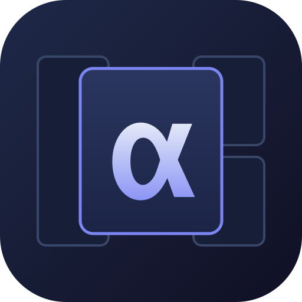
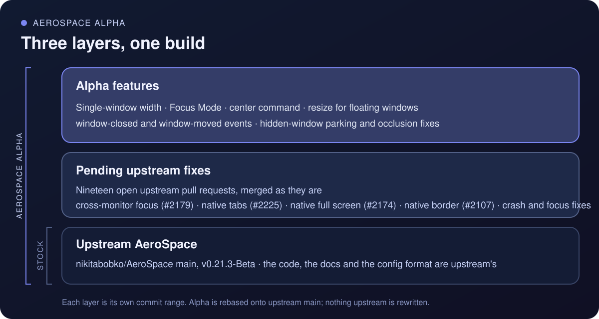

<p align="center">
  
</p>

<h1 align="center">AeroSpace α</h1>

<p align="center">
  An extended alpha build of <a href="https://github.com/nikitabobko/AeroSpace">AeroSpace</a>, the i3-like tiling window manager for macOS,<br>
  with the upstream fixes it is waiting for, new focus and single-window features,<br>
  and multi-monitor support that works, using the occasional private API<br>
  that would never make it into the main build.
</p>

<p align="center">
  <a href="https://github.com/JasonBates/AeroSpace-Alpha/releases/latest">download</a> ·
  <a href="https://github.com/nikitabobko/AeroSpace">upstream</a> ·
  <a href="docs/agent-setup.md">setup guide</a> ·
  <a href="docs/personal-build.md">build notes</a> ·
  <a href="LICENSE.txt">MIT</a>
</p>

<br>

## How it differs from AeroSpace

AeroSpace is a superb project: i3-style tiling on macOS, a plain-text config, a scriptable CLI, and no need to disable SIP. Alpha builds on that foundation and changes nothing about it. It adds a layer of upstream fixes that are still waiting to be merged, and a layer of features of its own on top.

<p align="center">
  
</p>

The bottom layer is upstream `main`, unchanged. The middle layer is a set of open upstream pull requests merged as they are, so bugs that upstream already has fixes for are fixed here now. The top layer is what I built for a three-monitor desk and a laptop. Everything else, from the config format to the CLI to the docs, is upstream's, and the credit for it belongs there.

One rule separates the two projects. Upstream does not use private macOS APIs, and holds to that even where the public APIs cannot do the job. Alpha uses them when there is no other way: today that is the SkyLight call that makes focus land on the right window across monitors. Those pieces can never be merged upstream, which is why this build exists.

In short, compared with stock AeroSpace:

- **Multi-monitor focus and movement work.** Focus lands on the window you asked for, hidden windows stay hidden, displays can reconfigure without a crash.
- **Floating windows behave.** They can be resized, centred and placed by rule, and dragged across monitors without jumping back.
- **A lone window gets a sensible width**, resizable from the keyboard, and Focus Mode centres and dims on demand.
- **Workspace bars get events** instead of polling.

## What Alpha adds

### Multi-monitor focus and movement that work

With "Displays have separate Spaces" on and an app open on two monitors, stock AeroSpace often focuses the wrong window: you ask for the Ghostty window on the right monitor, macOS raises it, and your keystrokes go to the one on the left ([issue #101](https://github.com/nikitabobko/AeroSpace/issues/101), open since 2024). Alpha fixes this with the SkyLight call from [PR #2179](https://github.com/nikitabobko/AeroSpace/pull/2179), so `focus` and `move` across monitors land where the highlight is, every time. Around it:

- Hidden windows on a middle monitor no longer flicker back into view, see [below](#hidden-windows-stay-hidden).
- Reconfiguring displays, plugging in or waking, no longer crashes AeroSpace ([#2232](https://github.com/nikitabobko/AeroSpace/pull/2232)).
- A monitor that macOS has already dropped, as when the lid closes with external displays attached or every display is briefly off, no longer crashes AeroSpace in an endless retry; it gets a placeholder workspace until the next refresh. Fix from [AeroSpace-edge](https://github.com/vitorebatista/AeroSpace-edge) ([PR #64](https://github.com/vitorebatista/AeroSpace-edge/pull/64)).
- `move-workspace-to-monitor` chooses the replacement workspace before moving ([#1944](https://github.com/nikitabobko/AeroSpace/pull/1944)).
- A cancelled focus request cannot steal focus from a newer one ([#2299](https://github.com/nikitabobko/AeroSpace/pull/2299)).

Tested daily on three side-by-side monitors and a laptop.

### Single-window width

A lone tiled window no longer fills the screen. `single-window-width-rules` gives it a percentage of the usable width, chosen by monitor size, and keeps it centred. On a 27-inch display a text editor at 50% is readable; on the laptop the same rule gives 66%.

<p align="center">
  
</p>

```toml
single-window-width-rules = [
  { min-monitor-width = 0,    width-percent = 66 },
  { min-monitor-width = 2000, width-percent = 50 },
]
```

**The centred window is resizable.** `resize smart +100` and `resize smart -100` widen or narrow it by 100 points, `resize width 1400` sets an exact width, and it stays centred throughout. The adjustment belongs to that window and lasts until it closes. Bind the same keys you use for tiles; with more than one tiled window they resize tiles as before.

```toml
ctrl-alt-cmd-minus = 'resize smart -100'
ctrl-alt-cmd-equal = 'resize smart +100'
```

### Focus Mode

`focus-mode` centres the focused window at the same width and dims every other window on every display behind a translucent layer. Press it again, click elsewhere or switch workspace and the layout returns exactly as it was, tree and tile weights intact. On three displays the window moves to the middle one. The same `resize` commands widen or narrow the focused window while it is centred.

<p align="center">
  
</p>

```toml
ctrl-alt-cmd-z = 'focus-mode'
```

### Floating windows that behave

- **`center`** centres a floating window on its monitor, shrinking it first if it is larger than the screen.
- **`resize` works on floating windows.** The window resizes around its centre and stays inside its monitor. `width` and `height` change one side; `smart` changes the longer side and `smart-opposite` the shorter, keeping the aspect ratio.
- **Dragging a floating window to another monitor lands it where you drop it.** Stock AeroSpace often pulls the window back to the monitor it came from ([issue #347](https://github.com/nikitabobko/AeroSpace/issues/347)), and with three monitors a drag from the first to the third reliably ends on the second. A layout pass was moving the window while the drag handler was still catching up; the window is now left alone until the mouse button is released, then bound to the monitor under it. Fix offered upstream on that issue.

Together with `on-window-detected` a rule can open a window floating, sized and centred:

```toml
[[on-window-detected]]
    if.app-id = 'com.apple.QuickTimePlayerX'
    run = ['layout floating', 'resize smart 1600', 'center']
```

### Events for workspace bars

`aerospace subscribe` gains `window-closed` and `window-moved`, so a bar can follow windows without polling `list-windows`. `window-moved` also reports moves made by `on-window-detected` callbacks, and minimising or restoring a window.

### Hidden windows stay hidden

AeroSpace parks the windows of invisible workspaces in a bottom corner of their monitor. When a monitor sits between two others, both of its bottom corners touch a neighbour, macOS pulls the parked window back onto that neighbour, and it flickers at the edge of the screen. Such a monitor now parks hidden windows in the nearest clean outer corner of another monitor.

### Aspect ratio for a lone window

The single-window and accordion aspect-ratio work from upstream [PR #2093](https://github.com/nikitabobko/AeroSpace/pull/2093), adapted to the current code. Alpha's width rules build on it.

## Upstream fixes included

Open upstream pull requests merged unchanged, except where noted. Credit belongs to their authors.

| PR | Fixes |
|---|---|
| [#2179](https://github.com/nikitabobko/AeroSpace/pull/2179) | With separate Spaces per display, focus lands on the requested window of a multi-window app instead of one on another monitor ([#101](https://github.com/nikitabobko/AeroSpace/issues/101)). Adapted to the `MonitorInfo` rename. |
| [#2225](https://github.com/nikitabobko/AeroSpace/pull/2225) | A new native tab in Finder or Ghostty takes its predecessor's place in the tree ([#68](https://github.com/nikitabobko/AeroSpace/issues/68)). |
| [#2174](https://github.com/nikitabobko/AeroSpace/pull/2174) | A window returns to its place in the layout after macOS native full screen. |
| [#2201](https://github.com/nikitabobko/AeroSpace/pull/2201) | Focus is restored after a transient dialog closes. |
| [#2299](https://github.com/nikitabobko/AeroSpace/pull/2299) | A cancelled focus request no longer steals focus from a newer one. |
| [#2220](https://github.com/nikitabobko/AeroSpace/pull/2220) | A window made floating by `on-window-detected` no longer stays at its tile position. |
| [#2281](https://github.com/nikitabobko/AeroSpace/pull/2281) | No `focus` crash when a floating window moves or closes during the command. |
| [#2232](https://github.com/nikitabobko/AeroSpace/pull/2232) | No crash while displays are being reconfigured. |
| [#1944](https://github.com/nikitabobko/AeroSpace/pull/1944) | `move-workspace-to-monitor` chooses the replacement workspace before moving. |
| [#2317](https://github.com/nikitabobko/AeroSpace/pull/2317) | The windows of an app that hangs or is too busy to answer Accessibility requests are no longer treated as closed ([#1216](https://github.com/nikitabobko/AeroSpace/issues/1216)). Merged by hand with #2225's native-tab handling. |

## Download

Each release on the [Releases page](https://github.com/JasonBates/AeroSpace-Alpha/releases/latest) is a zip with `AeroSpace.app`, the `aerospace` CLI, man pages and shell completion. The app is signed with a Developer ID and notarized by Apple, so it opens without Gatekeeper warnings.

1. Quit stock AeroSpace if it is running.
2. Unzip, move `AeroSpace.app` to `/Applications` and `bin/aerospace` somewhere on your `PATH`.
3. Launch it and grant Accessibility access when asked, as with upstream.

If you are setting up with an AI assistant, give it [docs/agent-setup.md](docs/agent-setup.md): a step-by-step guide to installing Alpha, mapping Caps Lock to the modifier with Karabiner-Elements, and adding trackpad swipes with SwipeAeroSpace.

Your existing `~/.aerospace.toml` works unchanged. The new keys and commands are listed above. To go back to stock AeroSpace, remove any Alpha-only keys from the config first, because stock rejects them.

**Provided as is, without warranty of any kind, express or implied. Use at your own risk.** This is a personal build; support is best effort, and the [MIT licence](LICENSE.txt) has the full terms. [Discussions](https://github.com/JasonBates/AeroSpace-Alpha/discussions), [issues](https://github.com/JasonBates/AeroSpace-Alpha/issues) and pull requests are welcome.

## Things to know

- **This is a personal build.** Releases appear when I rebuild for myself, not on a schedule. It is public so the code can be read and borrowed, and so the build can be downloaded. Discussions, issues and pull requests are open; I read them, but cannot promise a quick answer.
- **It tracks upstream.** The branch is rebased onto upstream `main`; nothing upstream is rewritten. Current base: v0.21.3-Beta.
- **#2179 uses a private macOS API.** Upstream has chosen not to ship private APIs. Alpha calls two undocumented SkyLight functions to fix cross-monitor focus. If the symbols are missing, Alpha falls back to stock focus behaviour for the session. If a call fails, it falls back for that request only, and switches the private path off after three failures in a row; restarting AeroSpace retries it.
- **The config is not backward compatible.** Stock AeroSpace rejects `single-window-width-rules` and the other new keys. Remove them before going back to a stock build.
- **Building:** releases are produced by the `release-alpha` GitHub workflow, which signs, notarizes and publishes a zip for a given version. Locally, `./build-personal-release.sh` produces a signed app and CLI from a clean working tree; it reads the signing identity from `~/.config/aerospace/env` (see `personal-build.env.example`). Details in the [build notes](docs/personal-build.md).

## Credit

AeroSpace is by [Nikita Bobko](https://github.com/nikitabobko) and its contributors, MIT licensed. The upstream fixes above are the work of their respective authors. The documentation for everything not listed on this page is [upstream's](https://nikitabobko.github.io/AeroSpace/guide).
